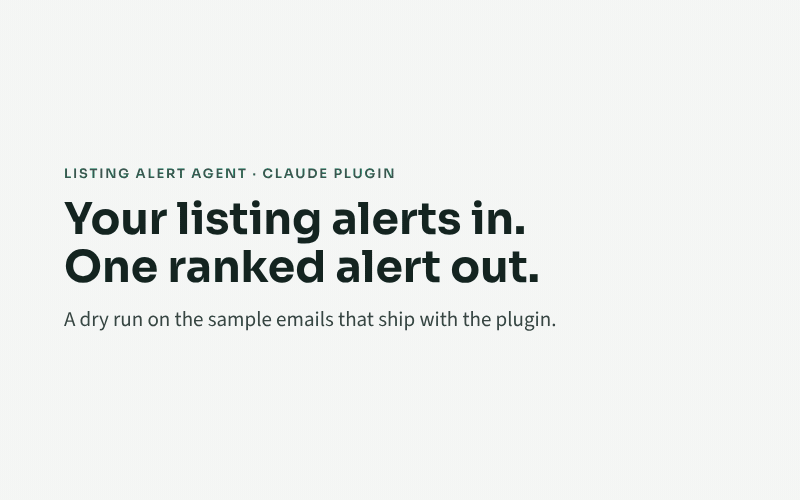

# Listing Alert Agent

A Claude plugin that turns the saved-search alert emails you already get from listing sites into one ranked, explained alert. It tells you what fits, why, how long the trip really is, and how the price compares with the local market.



> **Status: v0.3, pre-release.** Running daily for its author on real alerts. Not yet listed in the Claude plugin directory.

## The problem it solves

Listing sites send alerts for everything that matches a few filters. You still have to:

- open each one;
- work out the travel time to work;
- check whether the rent is fair for the area;
- notice that it is the same flat posted on two sites;
- decide fast before it goes.

Listing Alert Agent does that triage every hour and sends you one email with the answer.

[Watch the 60-second overview (MP4, captions and background music, no voiceover)](media/listing-alert-agent-60s.mp4) · [How it works, on one page (PNG)](media/how-it-works.png)

## What you get

- **Hourly alerts** sorted into *act now*, *stretch* and *over budget*. Each listing has a fit score out of 100 and the three reasons behind it.
- **Real drive times** to the places that matter to you, with directions links.
- **Market comparison** against open data. For Ireland, that is the RTB average agreed rents.
- **Monthly cost estimate**: your share of the rent, plus energy, plus commute.
- **Repeat, price-change and re-list detection**, and **possible-scam flags**.
- **Decision tools**: compare listings side by side, a viewing pack with the rules, and rule tuning from your verdicts.
- **A private dashboard**, a weekly summary, and a `doctor` check that explains what is wrong when alerts stop.

## How it works

```text
Listing sites ──(your saved-search alerts)──► Gmail
                                               │
                 listing-alert-agent (hourly)  ▼
   read new alert emails → extract listings → deal-breakers and areas → budget tier
   → drive time to your places → market comparison → monthly cost → fit score + reasons
   → repeats, price changes, re-lists → risk flags → one email + phone notification
                                               │
            your private state repository (settings, history, run log) → optional private dashboard
```

- **Email only.** The plugin never visits, searches or scrapes listing websites.
- **Your data stays yours.** Settings and history live in your own private GitHub repository, Google Drive folder or local folder.
- **Deterministic maths.** Rent conversion, scoring, travel lookup and duplicate detection run in a tested Python script. Claude reads the emails and explains the results.

## Get started

| You use Claude in | Guide |
|---|---|
| claude.ai, or the Claude desktop or mobile app | [docs/quickstart-claude-app.md](docs/quickstart-claude-app.md) |
| Claude Code | [docs/quickstart-claude-code.md](docs/quickstart-claude-code.md) |

In short:

1. Create your private state repository from the [template](https://github.com/murugkarpratik44/listing-alert-agent-state-template).
2. Add the plugin:
   - **Claude app:** go to **Customize → Plugins → Add → Add marketplace** and enter `murugkarpratik44/listing-alert-agent`.
   - **Claude Code:** run `/plugin install listing-alert-agent --marketplace murugkarpratik44/listing-alert-agent`.
3. Ask Claude: **"Set up listing alerts."** Setup:
   - interviews you;
   - builds your travel-time table;
   - sends a test alert;
   - gives you the prompts for the hourly schedule.

More: [how-tos](docs/quickstart.md#how-tos) · [FAQ](docs/faq.md) · [security](docs/security.md) · [privacy](docs/privacy.md).

## Packs

| Pack | Covers | Status |
|---|---|---|
| `ie-rentals` | Ireland rentals: Daft.ie and MyHome.ie alerts; RTB average rents (CC BY 4.0); SEAI and Revenue cost defaults; RTB viewing rules | MyHome.ie layout confirmed from real alerts; Daft.ie layout to be confirmed |
| `_template` | Start here to add a country or listing type: [write a pack](docs/how-to/write-a-pack.md) | – |

## Repository layout

| Path | Contents |
|---|---|
| `listing-alert-agent/` | The plugin: skills, engine script, packs, schemas, behaviour tests |
| `tests/` | Unit, schema and end-to-end tests on synthetic data (`python -m unittest discover -s tests`) |
| `tools/` | Pack, plugin-folder and monthly maintenance checks |
| `docs/` | Quick starts, how-tos, security, privacy, FAQ, design specification, test results |
| `media/` | Demo GIF, video and infographic (sample data only) |
| `.github/` | CI, release workflow, issue and pull request templates |

## Roadmap

- **v0.2:** compare, viewing pack, tune, cost estimate, Google Drive storage.
- **v0.3:** dashboard, listing statuses, behaviour tests, monthly maintenance check, release automation.
- **v1.0:** documentation, media, plugin directory listing.

Details are in [docs/design-spec.md](docs/design-spec.md).

## Contributing, security, licence

[CONTRIBUTING.md](CONTRIBUTING.md) · [SECURITY.md](SECURITY.md) · [CODE_OF_CONDUCT.md](CODE_OF_CONDUCT.md) · MIT licence.

Market data: Residential Tenancies Board / Central Statistics Office (CC BY 4.0). Routing: openrouteservice.org by HeiGIT; map data © OpenStreetMap contributors. Not affiliated with any listing site. All listings shown in the media are sample data.
